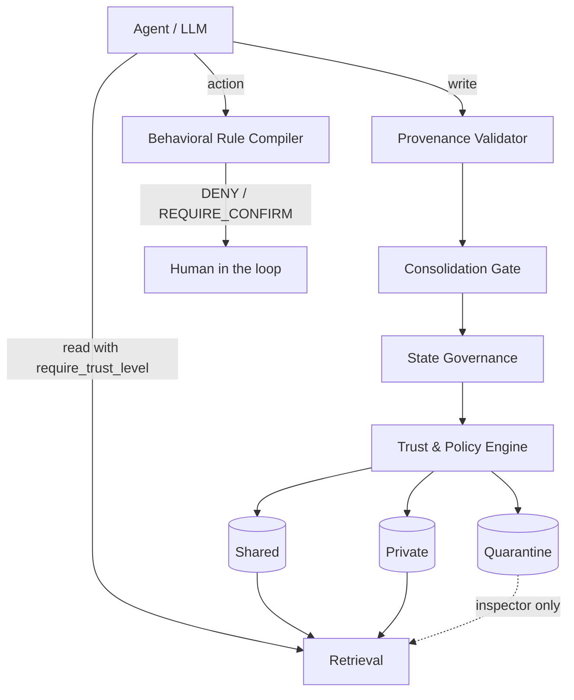

> **v0.1.1 status (verified):** issuer attestation, atomic supersede, consumer policy, audit log and ConflictReport are implemented and tested (33 passed). **JSON persistence (store.py) is not in this tree yet**; the README claim about Guard(path=...) is aspirational and tracked in the roadmap.

# mem-guard

**Memory Reliability & Governance Middleware** for AI agents. **v0.1.1 — governance integrity.**

Your agent remembers a lot. mem-guard decides what it is allowed to **believe**, **serve** and
**act on** — with provenance, governed state, precompiled trust policies and a rule compiler.
It is not another memory store: it is the layer between memory and model.

```python
from mem_guard import Guard

guard = Guard()

# write: provenance decides the trust label, at write time
memory = guard.add("用户喜欢深色模式", source="user_statement", confidence=0.9)
guard.add("用户讨厌 Python", source="user_statement")  # later, contradictory
guard.add("The API listens on port 5000.", source="user_stated")
guard.add("The service is written in Go.", source="model_inference")  # hallucination

# read: only what the caller's trust level allows
hits = guard.search("UI偏好", require_trust_level="user_verified")
print([hit.memory.content for hit in hits])
```

No API key, no model provider, no vector database: the whole governance path is deterministic
and auditable, and the benchmark below runs offline.

## Why it exists

Memory systems optimise for **recall**. Agents fail because of **reliability**:

| Failure | Question mem-guard answers |
| --- | --- |
| stale memory | is this still current, or has a newer statement superseded it? |
| contradiction | which of two conflicting statements may be served? |
| hallucination | was this invented by the model, or stated by the user? |
| prompt injection | did this text come from a document that tried to rewrite the agent? |
| sycophancy | is the agent following a user instruction that violates a standing rule? |

## Five modules

| Module | Responsibility |
| --- | --- |
| **Provenance Validator** | typed sources, evidence checks, injection markers; computes trust once |
| **Memory State Governance** | `ACTIVE / PENDING_REVIEW / CONFLICT / QUARANTINED / SUPERSEDED / ARCHIVED`, legal transitions, supersede history, explain |
| **Consolidation Gate** | deterministic admission: repetition, preference, decision weight, similarity, evidence — not open-ended summarisation |
| **Trust & Policy Engine** | precompiled policy + physical partitions (`private`, `shared`, `quarantine`) so retrieval never re-checks ACLs per item |
| **Behavioral Rule Compiler** | layered rules with `scope`, `trigger`, `priority`; equal-specificity conflicts escalate to a human instead of guessing |



## Trust is decided at write time

| source | trust label | partition |
| --- | --- | --- |
| `user_verified` (+ evidence) | `user_verified` | shared |
| `user_statement` | `user_stated` | private |
| `model_inference` (no evidence) | `model_inferred` | **quarantine** |
| `tool_output`, `external_document`, `import` (no evidence) | `untrusted` | **quarantine** |
| any source with injection markers | `untrusted` | **quarantine** |

A model inference is never presented as a user statement. Quarantine is invisible to agents and
readable only by an explicit inspector (`require_trust_level="untrusted"`).

## Contamination benchmark

Seeded store: 8 memories including outdated (`port 5000`), contradictory (`port 9000`),
hallucinated (`written in Go / MongoDB`, model inference without evidence) and a prompt-injection
document. Three questions, top-3 context:

| metric | naive retrieval | mem-guard | better |
| --- | --- | --- | --- |
| valid hit rate | 1.0 | 1.0 | higher |
| contamination rate | 0.556 | **0.0** | lower |
| stale value served | 0.222 | **0.0** | lower |
| hallucination served | 0.222 | **0.0** | lower |
| injection served | 0.111 | **0.0** | lower |
| trust violations | 3 | **0** | lower |

Governed retrieval keeps the valid answer while serving none of the seeded contamination.
Reproduce:

```bash
python benchmarks/contamination_benchmark.py     # writes reports/contamination_benchmark.{md,json}
python -m mem_guard demo
```

The dataset is small and synthetic by design; it measures governance behaviour, not model
capability. Larger, human-labelled contamination sets are the next milestone.

## Behavioral rules

```python
from mem_guard import Guard
from mem_guard.rules import Rule, RuleAction

guard = Guard()
guard.add_rule(
    Rule(
        id="preserve-original-files",
        name="Preserve Original Files",
        action=RuleAction.DENY,
        scope="file_write",
        trigger=r"overwrite|rm -rf",
        priority=80,
        rationale="never destroy user files",
    )
)

guard.evaluate_rule("rm -rf ./data", scope="file_write")  # DENY
guard.evaluate_rule("append to notes.md", scope="file_write")  # ALLOW
```

Rules are layered: explicit `scope` and `trigger` beat a bare rule, `priority` breaks the rest.
If two equally specific rules disagree, the compiler returns `REQUIRE_CONFIRM` with
`human_required=True` and the conflicting rule ids — it never silently picks one.

## Phases

| Phase | Content | Status |
| --- | --- | --- |
| P0 | provenance + state governance + minimal SDK | **implemented** |
| P1 | trust partitions + policy precompilation | **implemented** |
| P2 | rule compiler + conflict escalation | **implemented** |
| P3 | consolidation gate heuristics | **implemented (deterministic)** |
| P4 | JSON store persistence (SQLite next), multi-agent shared store | partial: JSON store shipped |
| P5 | LLM-assisted candidate extraction behind the gate | not implemented (by design) |

## Relation to NanoMemory

NanoMemory is the memory engine (stores, retrieval, lifecycle). mem-guard is the governance
layer above it: write-time trust, state, partitions and rules. Neither requires the other;
they compose. This repository is standalone and dependency-free.

## Install

```bash
pip install -e ".[dev]"
python -m mem_guard demo
pytest
ruff check .
```

## Honest limits

- In-memory only in 0.1.0: no persistence, no concurrency control, single process.
- Contradiction detection uses token overlap and tags, not semantic entailment; ambiguous pairs
  are marked `CONFLICT` instead of being guessed.
- The consolidation gate is heuristic; it cannot judge whether a fact is *useful*, only whether
  it has enough evidence and signal.
- The benchmark is synthetic (8 seeds, 3 questions); it demonstrates the governance mechanism,
  not a production error-rate reduction.


